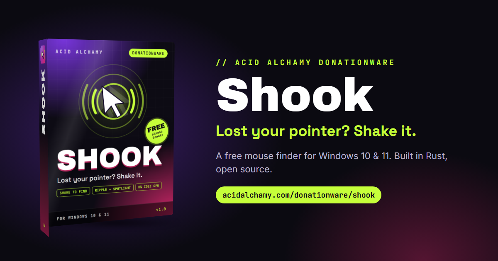
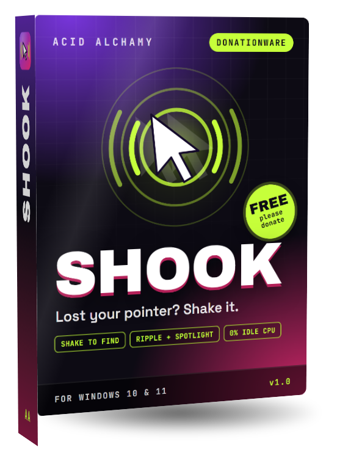
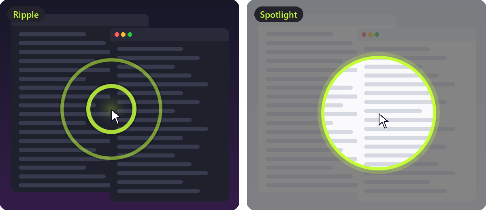
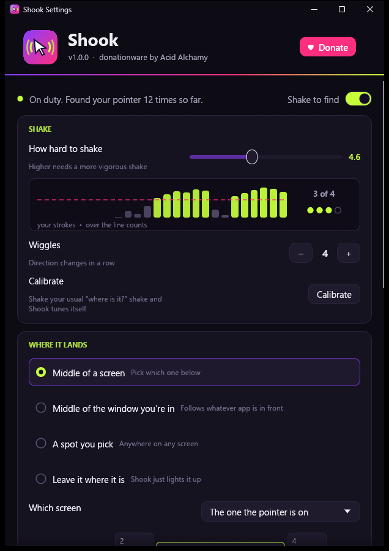
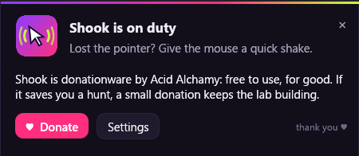
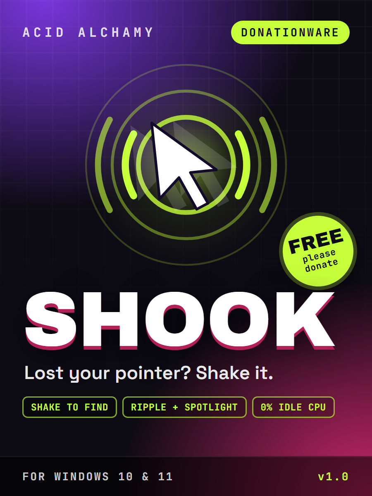

<div align="center">

<a href="https://acidalchamy.com/donationware/shook/"></a>

<br>

<a href="https://github.com/AcidAlchamy/shook/releases/latest/download/Shook.exe"></a>
&nbsp;
<a href="https://acidalchamy.com/donationware/shook/?from=github#donate"></a>

<br><br>

<a href="https://github.com/AcidAlchamy/shook/releases/latest"></a>


</div>

<br>

<table>
<tr>
<td width="44%" valign="top" align="center">

</td>
<td valign="top">

### Lost your pointer? Shake it.

Four screens, a 4K panel, a dark theme, and somewhere in there is a 32-pixel arrow.
**Shook** brings it back: give the mouse a quick shake and the pointer lands right
where you can see it, with a ripple or a spotlight so your eyes find it too.

It's a tiny, carefully built Windows tool. It sleeps until the mouse moves, uses
**zero CPU** while it waits, and gets out of the way when you're dragging, drawing
or gaming.

**Shook is donationware.** It's free to use, for good: no trial, no locked features,
no account. If it saves you a hunt, a [small donation](https://acidalchamy.com/donationware/shook/?from=github#donate)
keeps the lab building more tools like it.

</td>
</tr>
</table>

---

## ✦ What it does

| | |
|---|---|
| **Shake to find** | A few quick side-to-side shakes and the pointer jumps into view. Slow drags, long sweeps and hand tremor never set it off. |
| **Lands where you want** | The middle of the screen you're on, your main screen or any screen you pick, the middle of the window you're working in, a spot you pick, or right where it is. |
| **Hard to miss** | A **ripple** or a **spotlight**, in your color and at your size, that follows the pointer while it plays. A soft two-note chime, if you like. |
| **Stays put when it lands** | Your hand is still moving when Shook fires, so the pointer is held on its landing spot until the mouse settles. It never gets dragged away again. |
| **Tuned to your hand** | **Calibrate**: shake the way you always do and Shook sets its own threshold. A live meter shows every stroke and how close you are to a shake. |
| **Stays out of the way** | Ignores shakes while a mouse button is held, while a game or video is full screen, and in any app you list. Pause it from the tray. |
| **Hotkey, too** | Rather press a key? Set one (like <kbd>Ctrl</kbd>+<kbd>Alt</kbd>+<kbd>M</kbd>) and Shook finds the pointer without a shake. |
| **Featherweight** | Plain Win32 in Rust. No polling, no timers, about 2 MB of private memory. The UI only exists while it's on screen. |

<p align="center"></p>

## ✦ A look inside

<table>
<tr>
<td width="50%" valign="top"></td>
<td valign="top">

**Settings** (right-click the tray icon, or just run `Shook.exe` again):

- **Shake**: how hard, how many wiggles, and **Calibrate**. The meter shows your last strokes as bars; the ones over the pink line count.
- **Where it lands**: five modes and a live **map of your screens** with your pointer on it. Click a screen to land there, or click anywhere in *A spot you pick* mode.
- **Make it obvious**: Ripple, Spotlight or None, six colors plus a picker, size, sound, and a **Try it** button.
- **Behavior**: hotkey, the ignore rules, *Start with Windows*, and the hello card.

Every change saves on its own; there's no Save button.

<br>

**The hello card** says hi when Shook starts (you can turn it off):



</td>
</tr>
</table>

## ✦ Get started

1. **[Download `Shook.exe`](https://github.com/AcidAlchamy/shook/releases/latest/download/Shook.exe)** and run it. There's nothing to install.
2. Windows may say it doesn't recognize the publisher yet (Shook isn't code-signed). Choose **More info**, then **Run anyway**.
3. Shook settles into your tray (bottom right, maybe under the <kbd>^</kbd> arrow) and opens its settings once to say hello.
4. Lost the pointer? **Shake the mouse quickly side to side.** That's it.
5. Want it every time? Turn on **Start with Windows** in the settings.

### System requirements

| | |
|---|---|
| **System** | Windows 10 or 11, 64-bit |
| **Processor** | Anything that runs Windows 10 |
| **Memory** | About 2 MB while it waits |
| **Disk** | One 4.5 MB file |
| **Graphics** | OpenGL 2 for the settings window (any GPU from the last decade) |
| **Input** | Any mouse or touchpad. Pen tablets, remote desktop and VMs send absolute positions; Shook handles those too. |

### The tray menu

Right-click the icon: **Find my pointer** · **Pause shake to find** · **Settings…** · **Donate ♥** · **Shook on the web** · **Quit Shook**.
Left-click opens the settings.

## ✦ Light, measured

Numbers from a 2013 ThinkPad (i7-4600U) running Windows 10:

| | |
|---|---|
| Waiting for a shake | **0% CPU**: under 1 M CPU cycles in 10 seconds |
| Private memory | **1.8 MB** (8.5 MB working set) |
| Mouse moving nonstop at 1000 reports/second | about **3% of one core** on that 2013 CPU |
| While paused | Shook unregisters from mouse input entirely: zero work |

How it stays that light:

- The always-running part is plain Win32: a hidden window that receives **raw mouse input** (`RIDEV_INPUTSINK`) and blocks in `GetMessage` until the mouse moves. No hooks in the input chain, no polling, no timers.
- The settings window and the hello card are separate, short-lived processes of the same exe (egui). Nothing graphical stays loaded while Shook waits.
- The effects are click-through layered windows that exist for about a second, drawn by Shook's own anti-aliased renderer. The spotlight's dim layer is a single-alpha window with a round hole in its region, so even a 4K screen costs nothing to dim.

### How a shake is recognized

Each axis is tracked on its own, using raw sensor counts (before Windows applies pointer speed, so a pointer stuck at a screen edge still sees the whole shake).
A *stroke* is movement in one direction; it ends when the mouse reverses by more than a few counts.
A stroke counts toward a shake when it's long enough to not be tremor, quick enough to not be a drag (under 450 ms), and faster than your **How hard** setting.
**Wiggles** direction changes in a row, with no pause over 220 ms, make a shake. Up-and-down and little circles work too.

## ✦ Settings file

Everything lives in `%APPDATA%\Shook\settings.toml` (the settings window writes it; you can edit it by hand, then choose *Settings* in the tray to reload).

| Key | Default | Meaning |
|---|---|---|
| `paused` | `false` | Shaking does nothing (the hotkey still works) |
| `speed` | `4.0` | How hard to shake, `1` (gentle) to `10` (vigorous) |
| `wiggles` | `4` | Direction changes in a row that make a shake, `3` to `8` |
| `landing` | `"screen-center"` | `screen-center`, `window-center`, `spot` or `stay-put` |
| `screen` | `"pointer"` | For `screen-center`: `pointer`, `primary` or a display like `\\.\DISPLAY2` |
| `spot` | — | For `spot`: `[x, y]` in physical pixels on the desktop |
| `effect` | `"ripple"` | `ripple`, `spotlight` or `off` |
| `color` | `"#C6FF3A"` | The effect color |
| `size` | `1.0` | Effect size, `0.6` to `2.0` |
| `sound` | `false` | The chime |
| `hotkey` | `""` | Like `"Ctrl+Alt+M"`; empty = off |
| `ignore_dragging` | `true` | Ignore shakes while a mouse button is held |
| `ignore_fullscreen` | `true` | Ignore shakes while something is full screen |
| `ignore_apps` | `[]` | Program names to ignore shakes in, like `["photoshop.exe"]` |
| `hello_card` | `true` | Show the hello card at start |

## ✦ Privacy

Shook never connects to the internet. It reads mouse movement on your PC, writes its settings file, and that's all.
The *Donate* and website buttons just open your browser. No telemetry, no analytics, no update checks.

## ✦ Uninstall

Turn off **Start with Windows**, choose **Quit Shook** in the tray, then delete `Shook.exe` and the `%APPDATA%\Shook` folder.

## ✦ Build it yourself

You need Rust (stable, MSVC toolchain) and the Windows SDK (for the icon and manifest resources).

```
git clone https://github.com/AcidAlchamy/shook
cd shook
cargo build --release
```

The exe is `target\release\shook.exe`. Run the tests with `cargo test`.

The art is made from source too: `python art/icons.py` renders the icons from SVG (needs Edge and Pillow), and
`cargo test dump_frames -- --ignored` with `SHOOK_FRAMES=art/build/frames`, then `python art/effects.py`,
draws the README's effect images with the same renderer the app uses.

```
src/
  main.rs          one exe, three faces: resident, --settings, --hello
  shake.rs         the shake detector (pure, unit-tested)
  config.rs        settings.toml
  live.rs          shared memory for the live meter and calibration
  resident/        raw input, tray, landing, the effects, the chime
  ui/              the settings window and hello card (egui)
```

## ✦ Donationware

Shook is free, and it stays free. It's open source under the [MIT license](LICENSE), so you can read every line of it.

If it earns its keep on your desk, please consider a donation:
**[acidalchamy.com/donationware/shook](https://acidalchamy.com/donationware/shook/?from=github#donate)**.
Donations fund the hours, the hardware and the next small tool on the
[donationware shelf](https://acidalchamy.com/donationware/).

<br>

<div align="center">

<a href="https://acidalchamy.com/donationware/"></a>

<sub>Shook · made by <a href="https://acidalchamy.com/">Acid Alchamy</a> · donationware</sub>

</div>
